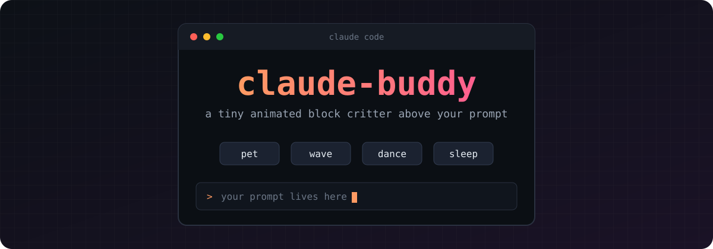

<div align="center">



<br>

**A little animated block critter that lives above the prompt in Claude Code.**


</div>

---

## What is it?

It sits, blinks, looks around and waves. While Claude is working it **dances**. When a turn finishes it waves **"all done!"**, and after 30 seconds of quiet it **falls asleep**.

Four buttons under it let you play with it.

> This is an unofficial, fan-made pixel approximation of a mascot, not official artwork.

## Install

In a Claude Code session:

```text
/plugin install buddy --marketplace Developer-Pratham/claude-buddy
```

Answer `y` to add the marketplace, then pick the **user** scope.

## Buttons

| Button | What happens |
| :----- | :----------- |
| **pet**   | Buddy enjoys it |
| **wave**  | Buddy waves back |
| **dance** | Buddy dances |
| **sleep** | Buddy naps |

## Moods

| When | Buddy |
| :--- | :---- |
| Idle | Sits, blinks, looks around |
| Claude is working | Dances |
| Turn finished | Waves "all done!" |
| 30 seconds of quiet | Falls asleep |

## What it does (and does not do)

- Draws a band above the prompt and updates it every 300 ms.
- Uses only two engine calls: `$.clock.every` and `$.ui.resolve`.
- **No** file, process, network, model or storage access.

## Notes

- It takes about 9 rows of screen space above the prompt.
- Button clicks need a terminal with mouse support.
- Tests: `claude plugin test buddy`.

## Project layout

```text
claude-buddy/
├── .claude-plugin/   marketplace and plugin manifest
├── buddy/            the plugin (TypeScript)
└── assets/           banner
```

---

<div align="center">

Made with care by [Pratham Maan Yadav](https://github.com/Developer-Pratham)

</div>
